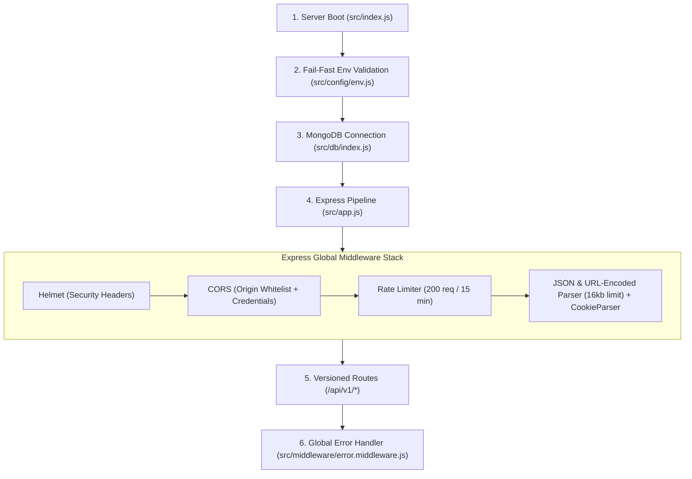

# 📖 Engineering Case Study: Building the Job Application Tracking System (ATS)

> [!NOTE]
> **How to Read This Case Study:** Instead of memorizing isolated facts, read this as **one continuous story**—from why the problem exists, to how the database and security were designed, to tracing a real candidate (**Bob**) and a real recruiter (**Alice**) through the exact lines of code as a job application moves from creation to hire.

---

## Chapter 1: The Real-World Problem (Why We Built This)

### 1.1 Why a Basic CRUD App Fails at Recruitment
Imagine a company hiring for two roles at the same time:
* **Role A (Summer Intern):** Only has **2 stages** (`Resume Screening` → `HR Chat`).
* **Role B (Senior Backend Engineer):** Has **4 stages** (`Resume Screening` → `OA Coding Test` → `System Design` → `Founder Round`).

If you build a basic CRUD job portal where an application simply has a string field `status: "Round 2"`, four things break immediately in the real world:
1. **Rigid Pipelines:** You cannot hardcode global stages because every job has a different number and order of stages.
2. **Illegal State Jumps:** Nothing stops a buggy UI or careless API call from moving a **Rejected** or **Withdrawn** candidate forward into `Round 3`, or advancing a candidate to `Stage 5` on a 2-stage job.
3. **Zero Accountability (No Audit Trail):** When a candidate asks *"When was I moved to the Technical Round, and who rejected me?"*, a plain `status` string overwrites the past.
4. **Broken Access Boundaries:** If Applicants and Recruiters share a single generic signup endpoint or user collection, a malicious user can pass `{ "role": "ADMIN" }` in the signup JSON body (mass-assignment privilege escalation) and take over the hiring portal.

### 1.2 The Engineering Goal
We set out to build a **production-hardened, API-first ATS Backend** using **Node.js (ES Modules), Express 5, and MongoDB (Mongoose 9)** that solves all four problems through:
1. **Customizable Per-Job Stage Arrays** embedded inside each job.
2. **A Deterministic Finite State Machine (`FSM`)** that validates every state transition before touching the database.
3. **An Append-Only Audit Log (`history`)** inside every application.
4. **Dual Authentication & Role-Based Access Control (RBAC)** separating `ADMIN` (Recruiters) from `APPLICANT` (Job Seekers).

---

## Chapter 2: Architectural Blueprint & Server Boot Sequence

Before a single user request arrives, how does the server start up and protect itself?



### What Happens in Code at Startup:
1. **[`src/index.js`](file:///d:/D%20drive/Aryan/Projects/Job-ATS-project/src/index.js):** The entry point loads `.env` via `dotenv`, calls [`validateRequiredEnv()`](file:///d:/D%20drive/Aryan/Projects/Job-ATS-project/src/config/env.js), and then connects to MongoDB via [`connectDB()`](file:///d:/D%20drive/Aryan/Projects/Job-ATS-project/src/db/index.js).
2. **Fail-Fast Startup ([`src/config/env.js`](file:///d:/D%20drive/Aryan/Projects/Job-ATS-project/src/config/env.js#L3-L13)):** Checks that `PORT`, `MONGODB_URI`, `JWT_ACCESS_SECRET`, and `JWT_REFRESH_SECRET` are non-empty, and `NODE_ENV` is `development`, `production`, or `test`. **Why?** If a secret is missing in production, the server refuses to boot immediately instead of crashing 3 hours later when the first user logs in.
3. **Global Defense Layer ([`src/app.js`](file:///d:/D%20drive/Aryan/Projects/Job-ATS-project/src/app.js#L15-L44)):**
   * `helmet()` sets HTTP headers like `X-Frame-Options` (prevents clickjacking) and `X-Content-Type-Options: nosniff` (prevents MIME-sniffing).
   * `cors(corsOptions)` restricts cross-origin requests to `process.env.CORS_ORIGIN` and enables `credentials: true` so `HttpOnly` cookies can be sent.
   * `rateLimit()` caps any single IP to **200 requests per 15 minutes** to block brute-force password attacks.
   * `express.json({ limit: "16kb" })` stops attackers from crashing the Node memory heap with massive JSON payloads.
4. **Standardized Response & Error Wrappers (`src/utils/`):**
   * [`asyncHandler.js`](file:///d:/D%20drive/Aryan/Projects/Job-ATS-project/src/utils/asyncHandler.js): Wraps every `async` controller in `Promise.resolve(...).catch(next)` so we never have to write repetitive `try/catch` blocks in controllers.
   * [`ApiError.js`](file:///d:/D%20drive/Aryan/Projects/Job-ATS-project/src/utils/ApiError.js) & [`error.middleware.js`](file:///d:/D%20drive/Aryan/Projects/Job-ATS-project/src/middleware/error.middleware.js): Any thrown error is caught at the bottom of [`app.js`](file:///d:/D%20drive/Aryan/Projects/Job-ATS-project/src/app.js#L67) and converted into a uniform JSON contract: `{ success: false, message, errors }`. Even unknown URLs hit the 404 fallback ([`app.js`](file:///d:/D%20drive/Aryan/Projects/Job-ATS-project/src/app.js#L59-L65)) and return JSON instead of Express's default HTML error page.

---

## Chapter 3: Data Modeling (Why These 4 Schemas?)

We designed **4 Mongoose collections** in `src/models/`. Here is the exact reasoning behind each schema design decision:

### 1. [`Recruiter`](file:///d:/D%20drive/Aryan/Projects/Job-ATS-project/src/models/recruiter.model.js) vs. [`Applicant`](file:///d:/D%20drive/Aryan/Projects/Job-ATS-project/src/models/applicant.model.js) (Why Two Separate User Collections?)
* **Recruiter Schema:** Has `name`, `email`, `CompanyName`, `passwordHash` (`select: false`), `refreshToken` (`select: false`), and `role: { type: String, enum: ["ADMIN"], default: "ADMIN", immutable: true }`.
* **Applicant Schema:** Has `name`, `email`, `passwordHash` (`select: false`), `resumeURL`, `appliedApplications: [ObjectId]`, `optionalContactInfo`, and `refreshToken` (`select: false`).
* **Why separate them?**
  1. **Zero Nullable Clutter:** Applicants don't have a `CompanyName`; Recruiters don't have a `resumeURL` or `appliedApplications`.
  2. **Hard Security Isolation:** By keeping Recruiters in a separate collection and **not exposing a public `/recruiter/signup` route**, an external user can *never* sign up as an Admin.
  3. **Automatic Password Hashing:** Both schemas use a Mongoose `pre("save")` hook ([`applicant.model.js`](file:///d:/D%20drive/Aryan/Projects/Job-ATS-project/src/models/applicant.model.js#L51-L58)) that checks `if (!this.isModified("passwordHash")) return;` and hashes the password with `bcrypt.hash(this.passwordHash, 10)`.
  4. **Hidden Sensitive Fields (`select: false`):** Marking `passwordHash` and `refreshToken` as `select: false` at the schema level guarantees that normal queries (like `findById()` or `.populate("appliedby")`) **never leak password hashes or tokens**.

### 2. [`JobProfile`](file:///d:/D%20drive/Aryan/Projects/Job-ATS-project/src/models/jobProfile.model.js) (Embedded Custom Pipelines)
* Stores `title`, `description`, `skillReq: [String]`, `numberOfPositions` (`min: 1`), `isOpen` (`default: true`), and `jobStages: [{ name: String }]` (with `{ _id: false }`).
* **Why embed `jobStages` as an array inside `JobProfile` instead of a separate `Stages` collection?**
  * Stages belong exclusively to one job and are always read together with that job. Embedding them gives us **0-join reads** and lets us track a candidate's progress using a simple integer index (`0, 1, 2...`).

### 3. [`Application`](file:///d:/D%20drive/Aryan/Projects/Job-ATS-project/src/models/application.model.js) (The State & Audit Record)
* Links an Applicant to a Job via `appliedby` (`ObjectId -> Applicant`) and `appliedto` (`ObjectId -> JobProfile`).
* Tracks current state via two fields:
  * `currentStageIndex` (`Number`, starts at `0`)
  * `terminalStatus` (`"HIRED" | "REJECTED" | "WITHDRAWN" | null`, starts at `null`)
* Tracks the complete audit trail via `history: [historySchema]`, where every move records `{ action, performedbyRole, fromStageIndex, toStageIndex, timestamp }`.

---

## Chapter 4: The Live Code Walkthrough (Tracing Alice & Bob)

Now let’s trace a **complete real-world lifecycle** through your code.
* **Alice** is a Recruiter (`ADMIN`).
* **Bob** is a Job Seeker (`APPLICANT`).

---

### 🎬 Act 1: Provisioning & Logging In Alice the Recruiter

#### Step 1.1: How Alice's Account Exists
Alice cannot sign up on the website because we deliberately removed `/api/v1/auth/recruiter/signup` from [`src/routes/auth.route.js`](file:///d:/D%20drive/Aryan/Projects/Job-ATS-project/src/routes/auth.route.js). Instead, an administrator runs [`src/scripts/seedRecruiter.js`](file:///d:/D%20drive/Aryan/Projects/Job-ATS-project/src/scripts/seedRecruiter.js), which connects to MongoDB and seeds `admin@company.com` (`role: "ADMIN"`).

#### Step 1.2: Alice Logs In (`POST /api/v1/auth/recruiter/login`)
1. Request hits [`recruiterLogin`](file:///d:/D%20drive/Aryan/Projects/Job-ATS-project/src/controller/auth.controller.js#L298-L341).
2. **Querying with `+passwordHash`:**
   ```javascript
   const recruiter = await Recruiter.findOne({ email }).select("+passwordHash");
   ```
   *(Because `passwordHash` has `select: false` in the schema, `.select("+passwordHash")` is required here so `bcrypt` can compare it!)*
3. **Verifying Password:** Calls `await recruiter.comparePassword(password)` in [`recruiter.model.js`](file:///d:/D%20drive/Aryan/Projects/Job-ATS-project/src/models/recruiter.model.js#L52-L54), which runs `bcrypt.compare(password, this.passwordHash)`.
4. **Split-Token Issuance ([`src/utils/token.js`](file:///d:/D%20drive/Aryan/Projects/Job-ATS-project/src/utils/token.js)):**
   * Creates payload `{ id: recruiter._id, role: "ADMIN" }`.
   * Generates a **short-lived Access Token** (`JWT_ACCESS_SECRET`) and a **long-lived Refresh Token** (`JWT_REFRESH_SECRET`).
5. **Saving Refresh Token & Setting Cookie:**
   * Saves `recruiter.refreshToken = refreshToken` in MongoDB via `await recruiter.save({ validateBeforeSave: false })`.
   * Sends the Refresh Token in an `HttpOnly`, `sameSite: "strict"` cookie (invisible to JavaScript XSS attacks) and returns the Access Token in the JSON body.

---

### 🎬 Act 2: Alice Creates a Backend Engineer Job (`POST /api/v1/jobs`)

Alice sends a `POST /api/v1/jobs` request with her `Authorization: Bearer <accessToken>` header and body:
```json
{
  "title": "Backend Engineer",
  "description": "Build Node.js APIs",
  "numberOfPositions": 2,
  "skillReq": ["Node.js", "MongoDB"],
  "jobStages": [{ "name": "Resume Screening" }, { "name": "Technical Interview" }]
}
```

#### What Happens in Code ([`src/routes/job.route.js`](file:///d:/D%20drive/Aryan/Projects/Job-ATS-project/src/routes/job.route.js) → [`src/controller/job.controller.js`](file:///d:/D%20drive/Aryan/Projects/Job-ATS-project/src/controller/job.controller.js)):
1. **Middleware 1 – [`verifyJwt`](file:///d:/D%20drive/Aryan/Projects/Job-ATS-project/src/middleware/auth.middleware.js#L5-L35):**
   * Checks `req.headers.authorization.startsWith("Bearer ")`.
   * Verifies the token with `jwt.verify(token, process.env.JWT_ACCESS_SECRET)`.
   * Attaches `req.user = { id: aliceId, role: "ADMIN" }` and calls `next()`.
2. **Middleware 2 – [`authorizeRoles("ADMIN")`](file:///d:/D%20drive/Aryan/Projects/Job-ATS-project/src/middleware/authorizeRoles.middleware.js#L4-L12):**
   * Checks `allowedRoles.includes(req.user.role)`. Since `"ADMIN"` is allowed, it calls `next()`. (If Bob tried this with an `"APPLICANT"` token, it would immediately throw `403 UnAuthorized Action`).
3. **Controller – [`createJob`](file:///d:/D%20drive/Aryan/Projects/Job-ATS-project/src/controller/job.controller.js#L33-L54):**
   * Calls pure helper [`validateJobPayload()`](file:///d:/D%20drive/Aryan/Projects/Job-ATS-project/src/controller/job.controller.js#L7-L31): verifies `title` and `description` are non-empty strings, `jobStages` is a non-empty array, and `numberOfPositions >= 1`.
   * Trims all strings and saves the new `JobProfile` in MongoDB with `isOpen: true`.
   * Notice `jobStages` now has **length 2**:
     * Index `0`: `"Resume Screening"`
     * Index `1`: `"Technical Interview"`

---

### 🎬 Act 3: Bob Signs Up & Uploads His Resume

#### Step 3.1: Bob Registers (`POST /api/v1/auth/signup`)
1. Hits [`applicantSignup`](file:///d:/D%20drive/Aryan/Projects/Job-ATS-project/src/controller/auth.controller.js#L13-L62).
2. Checks `Applicant.findOne({ email })` to block duplicates.
3. Calls `Applicant.create({ name, email, passwordHash: password })`.
   * **Under the hood:** Mongoose triggers the `pre("save")` hook in [`applicant.model.js`](file:///d:/D%20drive/Aryan/Projects/Job-ATS-project/src/models/applicant.model.js#L51-L58), hashing Bob's plain-text password with `bcrypt` (10 salt rounds) before writing to disk.
4. Issues Bob an Access Token (`role: "APPLICANT"`) and an `HttpOnly` Refresh Token cookie.

#### Step 3.2: Bob Uploads His Resume (`POST /api/v1/applicants/resume/upload`)
Bob can either link an external resume URL (`PATCH /api/v1/applicants/resume`, validated by [`validateResumeUrl`](file:///d:/D%20drive/Aryan/Projects/Job-ATS-project/src/controller/applicant.controller.js#L99-L116) using Node's native `new URL()` parser to enforce `http:` or `https:`) OR upload a file directly:
1. **Route & Multer Guard ([`src/routes/applicant.route.js`](file:///d:/D%20drive/Aryan/Projects/Job-ATS-project/src/routes/applicant.route.js#L22-L50)):**
   * Verified by `verifyJwt` + `authorizeRoles("APPLICANT")`.
   * Processed by `upload.single("resume")`: Multer checks that the file size is `<= 2MB` (`2 * 1024 * 1024` bytes) and the MIME type is strictly PDF, DOC, or DOCX.
   * Saves the file to `public/uploads/resumes/resume-<bobId>-<timestamp>.pdf`.
2. **Controller Validation ([`uploadApplicantResume`](file:///d:/D%20drive/Aryan/Projects/Job-ATS-project/src/controller/applicant.controller.js#L261-L293)):**
   * Runs [`validateResumeFile(req.file)`](file:///d:/D%20drive/Aryan/Projects/Job-ATS-project/src/controller/applicant.controller.js#L14-L28) as a second layer of defense.
   * Updates `applicant.resumeURL = "/uploads/resumes/..."` and returns Bob's updated profile.

---

### 🎬 Act 4: Bob Applies to Alice's Job (`POST /api/v1/applicants/apply/:jobId`)

Bob clicks "Apply" on Alice's Backend Engineer job.

#### What Happens Inside [`applyToJob`](file:///d:/D%20drive/Aryan/Projects/Job-ATS-project/src/controller/applicant.controller.js#L118-L179):
1. **ID Validation:** Checks `mongoose.Types.ObjectId.isValid(jobId)` and `applicantId`.
2. **Existence & Open-Job Check:**
   * Fetches the job via `JobProfile.findById(jobId)`.
   * Calls [`canApplicantApplyToJob(fetchedJobProfile)`](file:///d:/D%20drive/Aryan/Projects/Job-ATS-project/src/controller/applicant.controller.js#L91-L97). If Alice had closed the job (`isOpen: false`), it throws `400 This job is currently closed for applications`.
3. **Duplicate Application Prevention:**
   * Queries `Application.findOne({ appliedby: bobId, appliedto: jobId })`.
   * If Bob already applied, it throws `409 Application Already Under Review`.
4. **Initializing the Application & First Audit Log:**
   * Creates the `Application` document starting at **Stage Index `0`** (`"Resume Screening"`) and **`terminalStatus: null`**.
   * Pushes the first entry into `application.history`:
     ```json
     {
       "action": "APPLIED_TO_JOB",
       "performedbyRole": "APPLICANT",
       "fromStageIndex": null,
       "toStageIndex": 0
     }
     ```
   * Pushes `newApplication._id` into Bob's `appliedApplications` array and returns `201 Created`.

---

### 🎬 Act 5: The FSM in Action — Moving Bob Through the Pipeline

Right now, Bob's `Application` document in MongoDB looks like this:
* `currentStageIndex: 0` (`"Resume Screening"`)
* `terminalStatus: null`
* `history: [{ action: "APPLIED_TO_JOB", fromStageIndex: null, toStageIndex: 0 }]`

#### Step 5.1: Alice Advances Bob to Stage 1 (`PATCH /api/v1/applications/:id/advance`)
1. Hits [`advanceApplicationStage`](file:///d:/D%20drive/Aryan/Projects/Job-ATS-project/src/controller/application.controller.js#L19-L68) (`ADMIN` only).
2. Calls `assertApplicationActionAllowed(application, "advance")` ([`L9-L17`](file:///d:/D%20drive/Aryan/Projects/Job-ATS-project/src/controller/application.controller.js#L9-L17)): confirms `application.terminalStatus === null`.
3. Calls [`FSM()`](file:///d:/D%20drive/Aryan/Projects/Job-ATS-project/src/utils/applicationFsm.js#L4-L45) with:
   * `currentStageIndex: 0`
   * `jobStages: [{ name: "Resume Screening" }, { name: "Technical Interview" }]` (length `2`)
   * `terminalStatus: null`
   * `action: "NEXT_STAGE"`
4. **Inside [`FSM()`](file:///d:/D%20drive/Aryan/Projects/Job-ATS-project/src/utils/applicationFsm.js#L10-L21):**
   * `nextIndex = 0 + 1 = 1`.
   * Is `1 >= 2` (`jobStages.length`)? **False!** So Stage 1 exists.
   * Returns `{ nextStageIndex: 1, terminalStatus: null }`.
5. **Controller Updates DB:**
   * Appends `{ action: "STAGE_MOVED", performedbyRole: "ADMIN", fromStageIndex: 0, toStageIndex: 1 }` to `history`.
   * Sets `application.currentStageIndex = 1` (`"Technical Interview"`) and saves.

#### Step 5.2: What If Alice Accidentally Clicks "Advance" Again at Stage 1?
* Bob is now at `currentStageIndex: 1` (the final stage of this 2-stage job).
* If Alice calls `PATCH /api/v1/applications/:id/advance` again:
  * Inside [`FSM()`](file:///d:/D%20drive/Aryan/Projects/Job-ATS-project/src/utils/applicationFsm.js#L11-L15): `nextIndex = 1 + 1 = 2`.
  * Check: `if (nextIndex >= jobStages.length)` → `2 >= 2` is **TRUE!**
  * `FSM()` throws `400 Invalid Transition: no next Stage Available`.
  * **Result:** The database is never touched. Alice must make a final decision: **Hire** or **Reject** (or Bob can **Withdraw**).

#### Step 5.3: Alice Hires Bob (`PATCH /api/v1/applications/:id/hire`)
1. Hits [`hireApplication`](file:///d:/D%20drive/Aryan/Projects/Job-ATS-project/src/controller/application.controller.js#L147-L179).
2. Calls `FSM({ currentStageIndex: 1, terminalStatus: null, action: "HIRE" })`.
3. `FSM()` returns `{ nextStageIndex: 1, terminalStatus: "HIRED" }`.
4. Controller appends `{ action: "HIRED", performedbyRole: "ADMIN", fromStageIndex: 1, toStageIndex: null }` to `history`, sets `application.terminalStatus = "HIRED"`, and saves.

#### Step 5.4: What If Bob Tries to Withdraw *After* Being Hired (`PATCH /api/v1/applications/:id/withdraw`)?
1. Even though Bob owns the application (`application.appliedby.toString() === req.user.id` in [`withdrawApplication`](file:///d:/D%20drive/Aryan/Projects/Job-ATS-project/src/controller/application.controller.js#L118-L120)), both `assertApplicationActionAllowed` AND line 5 of [`FSM()`](file:///d:/D%20drive/Aryan/Projects/Job-ATS-project/src/utils/applicationFsm.js#L5-L7) check:
   ```javascript
   if (terminalStatus !== null) {
       throw new ApiError(400, "Invalid Transition: application already in terminal State.");
   }
   ```
2. Because `terminalStatus` is `"HIRED"`, the request is immediately rejected with `400 Bad Request`. The terminal state is permanently locked!

---

### 🎬 Act 6: Role-Isolated Viewing & Recruiter Dashboard

#### 1. How Filtering Protects Privacy ([`getAllApplications`](file:///d:/D%20drive/Aryan/Projects/Job-ATS-project/src/controller/application.controller.js#L181-L193) & [`getFilteredApplication`](file:///d:/D%20drive/Aryan/Projects/Job-ATS-project/src/controller/application.controller.js#L219-L239))
Both Recruiters and Applicants call the exact same endpoint: `GET /api/v1/applications`. How does the controller stop Bob from seeing other people's applications?
```javascript
const filter = {};
if (req.user.role === "APPLICANT") {
    filter.appliedby = req.user.id; // Forces MongoDB query to ONLY return Bob's records!
}
const applications = await Application.find(filter).populate('appliedby').populate('appliedto');
```
Even on `GET /api/v1/applications/filter?applicantId=someoneElse`, if `req.user.role === "APPLICANT"`, the controller overwrites `filter.appliedby = req.user.id` ([`L227-L229`](file:///d:/D%20drive/Aryan/Projects/Job-ATS-project/src/controller/application.controller.js#L227-L229)) so an applicant can never snoop on another applicant's ID.

#### 2. How Alice's Dashboard Aggregates Metrics (`GET /api/v1/auth/recruiter/dashboard`)
In [`getRecruiterDashboardStats`](file:///d:/D%20drive/Aryan/Projects/Job-ATS-project/src/controller/auth.controller.js#L250-L296):
1. Instead of running 4 database count queries one after another (slow sequential `await`), it fires all 4 simultaneously in parallel using `Promise.all`:
   ```javascript
   const [totalJobs, totalApplications, openJobs, totalApplicants] = await Promise.all([
       JobProfile.countDocuments(),
       Application.countDocuments(),
       JobProfile.countDocuments({ isOpen: true }),
       Applicant.countDocuments()
   ]);
   ```
2. Then it runs a **MongoDB Aggregation Pipeline** to group all applications by their `terminalStatus` (`null` for active, `"HIRED"`, `"REJECTED"`, `"WITHDRAWN"`):
   ```javascript
   const stageSummary = await Application.aggregate([
       { $group: { _id: "$terminalStatus", count: { $sum: 1 } } }
   ]);
   ```

---

## Chapter 5: The 5-Minute Pre-Interview Cheat Sheet

If you only have 5 minutes before your interview starts, review these 5 points:

1. **Why this project exists:** To replace unstructured CRUD status strings with a **customizable per-job hiring pipeline** governed by a **Finite State Machine (`FSM`)** and an **audit trail (`history`)**.
2. **Why `FSM` is a pure function ([`applicationFsm.js`](file:///d:/D%20drive/Aryan/Projects/Job-ATS-project/src/utils/applicationFsm.js)):** It has zero database/Mongoose dependencies—plain object in, plain object out—making it a single source of truth across 4 controllers and unit-testable in milliseconds.
3. **Why two user models (`Recruiter` & `Applicant`):** Different domain fields (`CompanyName` vs. `resumeURL`/`appliedApplications`) and strict privilege isolation (no public signup route for Recruiters; `role: "ADMIN"` is `immutable: true`).
4. **Why split-token auth (Access Token + `HttpOnly` Refresh Cookie + DB storage):** Short-lived Bearer token (`15m`/`1d`) keeps API calls fast and stateless; `HttpOnly` cookie protects the refresh token from XSS; storing the refresh token in MongoDB allows immediate server-side session revocation on logout.
5. **What you would improve next for scale:**
   * Add a compound unique index `{ appliedby: 1, appliedto: 1 }` + MongoDB transactions in [`applyToJob`](file:///d:/D%20drive/Aryan/Projects/Job-ATS-project/src/controller/applicant.controller.js#L118-L179) to eliminate concurrent TOCTOU race conditions.
   * Move resume uploads from local `Multer` disk storage (`public/uploads/resumes`) to AWS S3 / Cloudinary.
   * Add cursor/offset pagination (`.skip().limit()`) to `GET /jobs` and `GET /applications`.

