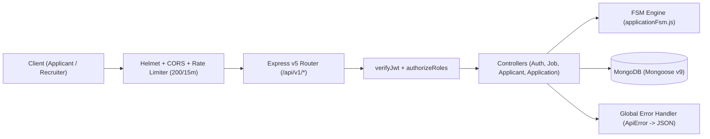

# 🛡️ Project Defense Sheet & Complete Interview Master Guide: Job ATS

> [!TIP]
> **How to Win the Interview:** Interviewers test three things:
> 1. **Ownership:** Did you actually write and debug this code? *(Prove it with the exact bugs you hit in Mongoose v9, `bcrypt.compare`, and `.select("+refreshToken")`).*
> 2. **Design Reasoning ("Why"):** Why a Finite State Machine instead of a status string? Why split-token auth? Why two user collections?
> 3. **Self-Awareness ("Trade-offs"):** Can you spot concurrency edge cases, scaling bottlenecks, and transaction boundaries in your own code?

---

## ⏱️ Part 1: Your Pitch Arsenal (30s, 60s, 2m)

### ⚡ 30-Second Opener ("Tell me about this project")
> "I built the backend for a **Job Application Tracking System (ATS)** using **Node.js, Express 5, and MongoDB**.
>
> Instead of a basic CRUD job portal where an application's status is just a text field, I designed it around a **Finite State Machine** ([`FSM`](file:///d:/D%20drive/Aryan/Projects/Job-ATS-project/src/utils/applicationFsm.js#L4-L45)). Recruiters create jobs with custom multi-stage interview pipelines, and the state machine strictly controls how candidates move through stages—blocking invalid jumps, locking finalized applications (`HIRED`, `REJECTED`, `WITHDRAWN`), and logging an audit trail for every action.
>
> It also features **dual authentication flows** with split-token JWTs (`Bearer` access token + `HttpOnly` refresh cookie), role-based access control between Recruiters and Applicants, `Multer` resume uploads, and **22 automated Jest and Supertest tests**."

---

## 🧠 Part 2: End-to-End Request Lifecycles (Know Every Hop)

If an interviewer asks **"Walk me through what happens in your code when X happens"**, trace these exact paths:

### Flow A: Applicant Logs In (`POST /api/v1/auth/login`)
1. **Global Middleware ([`src/app.js`](file:///d:/D%20drive/Aryan/Projects/Job-ATS-project/src/app.js#L30-L43)):** Request passes through `helmet()`, `cors()`, `rateLimit()` (max 200 req / 15m), `express.json({ limit: "16kb" })`, and `cookieParser()`.
2. **Route ([`auth.route.js`](file:///d:/D%20drive/Aryan/Projects/Job-ATS-project/src/routes/auth.route.js#L19)):** Dispatches to [`applicantLogin`](file:///d:/D%20drive/Aryan/Projects/Job-ATS-project/src/controller/auth.controller.js#L121-L167), wrapped in [`asyncHandler`](file:///d:/D%20drive/Aryan/Projects/Job-ATS-project/src/utils/asyncHandler.js).
3. **Database Lookup with Explicit Selection:** Runs `Applicant.findOne({ email }).select("+passwordHash")`. *(Why? Because `passwordHash` has `select: false` in [`applicant.model.js`](file:///d:/D%20drive/Aryan/Projects/Job-ATS-project/src/models/applicant.model.js#L20-L24), so Mongoose hides it unless explicitly requested).*
4. **Password Verification:** Calls `applicant.comparePassword(password)` which runs `bcrypt.compare(password, this.passwordHash)`.
5. **Split-Token Generation ([`token.js`](file:///d:/D%20drive/Aryan/Projects/Job-ATS-project/src/utils/token.js)):**
   * Generates `accessToken` (`JWT_ACCESS_SECRET`, default `15m` or `.env` `1d`) containing `{ id, role: "APPLICANT" }`.
   * Generates `refreshToken` (`JWT_REFRESH_SECRET`, default `7d` or `.env` `10d`).
6. **Persistence & Delivery:** Saves `refreshToken` on the `Applicant` document in MongoDB, sets the `refreshToken` in an `HttpOnly`, `sameSite: "strict"`, `secure` (in prod) cookie, and returns the `accessToken` + sanitized profile via [`ApiResponse`](file:///d:/D%20drive/Aryan/Projects/Job-ATS-project/src/utils/ApiResponse.js).

### Flow B: Applicant Applies to a Job (`POST /api/v1/applicants/apply/:jobId`)
1. **Auth & RBAC Guard ([`applicant.route.js`](file:///d:/D%20drive/Aryan/Projects/Job-ATS-project/src/routes/applicant.route.js#L51)):**
   * [`verifyJwt`](file:///d:/D%20drive/Aryan/Projects/Job-ATS-project/src/middleware/auth.middleware.js) verifies the `Authorization: Bearer <token>` header and attaches `req.user = { id, role }`.
   * [`authorizeRoles("APPLICANT")`](file:///d:/D%20drive/Aryan/Projects/Job-ATS-project/src/middleware/authorizeRoles.middleware.js) blocks `ADMIN` tokens with `403 Forbidden`.
2. **Validation & Business Rules ([`applyToJob`](file:///d:/D%20drive/Aryan/Projects/Job-ATS-project/src/controller/applicant.controller.js#L118-L179)):**
   * Validates `jobId` and `applicantId` using `mongoose.Types.ObjectId.isValid()`.
   * Fetches `JobProfile`; if missing (`404`) or closed via [`canApplicantApplyToJob`](file:///d:/D%20drive/Aryan/Projects/Job-ATS-project/src/controller/applicant.controller.js#L91-L97) (`job.isOpen === false`), throws `400 Bad Request`.
   * Checks `Application.findOne({ appliedby: applicantId, appliedto: jobId })`. If found, throws `409 Conflict ("Application Already Under Review")`.
3. **State Initialization & Audit Log:**
   * Creates `Application` at `currentStageIndex: 0`, `terminalStatus: null`.
   * Pushes initial audit record `{ action: "APPLIED_TO_JOB", performedbyRole: "APPLICANT", fromStageIndex: null, toStageIndex: 0 }` to `application.history`.
   * Pushes `newApplication._id` into `fetchedApplicant.appliedApplications` and saves.

### Flow C: Recruiter Advances or Finalizes an Application (`PATCH /api/v1/applications/:id/advance`)
1. **Auth & RBAC Guard:** Verified by `verifyJwt` + `authorizeRoles("ADMIN")`.
2. **Pre-Flight Checks ([`advanceApplicationStage`](file:///d:/D%20drive/Aryan/Projects/Job-ATS-project/src/controller/application.controller.js#L19-L68)):**
   * Calls `assertApplicationActionAllowed(application, "advance")` — throws `404` if missing or `400` if `application.terminalStatus !== null`.
   * Fetches `JobProfile` to inspect `appliedJob.jobStages`. Verifies stages exist and `currentStageIndex < appliedJob.jobStages.length`.
3. **FSM Execution ([`FSM`](file:///d:/D%20drive/Aryan/Projects/Job-ATS-project/src/utils/applicationFsm.js#L4-L45)):**
   * Computes `nextIndex = currentStageIndex + 1`.
   * Throws `400 Invalid Transition: no next Stage Available` if `nextIndex >= jobStages.length` (e.g., if the candidate is already on the final stage).
4. **History Append & Save:** Appends `{ action: "STAGE_MOVED", performedbyRole: "ADMIN", fromStageIndex, toStageIndex }` to `application.history`, updates `currentStageIndex`, and saves.

---

## 🐛 Part 3: Real Bugs You Hit & Fixed (Gold for Interviews!)

When an interviewer asks **"Tell me about a tricky bug you debugged in this project"**, use one of these **4 real bugs from your codebase**:

### 1. The Mongoose v9 `async` Pre-Save Hook Bug (`next is not a function`)
* **Where:** [`src/models/applicant.model.js`](file:///d:/D%20drive/Aryan/Projects/Job-ATS-project/src/models/applicant.model.js#L51-L58)
* **What Happened:** When writing the `applicantSchema.pre('save', async function(next) { ... })` hook to hash passwords with `bcrypt`, calling `next()` at the end crashed with `TypeError: next is not a function`.
* **Root Cause:** In modern Mongoose (v7–v9), `async` middleware functions return a Promise; Mongoose resolves the hook automatically when the `async` function finishes and **does not pass a `next` callback** to `async` hooks.
* **Fix:** Removed `next()` and used early `return;` statements when `!this.isModified('passwordHash')`.

### 2. Silent Refresh Token Failure Due to Schema `select: false`
* **Where:** [`src/controller/auth.controller.js`](file:///d:/D%20drive/Aryan/Projects/Job-ATS-project/src/controller/auth.controller.js#L184) & [`L351-L355`](file:///d:/D%20drive/Aryan/Projects/Job-ATS-project/src/controller/auth.controller.js#L351-L355)
* **What Happened:** During token refresh (`refreshRecruiterAccessToken` / `refreshApplicantAccessToken`), comparing `recruiter.refreshToken !== incomingRefreshToken` always failed with `401 Refresh token is invalid or revoked`, even right after login.
* **Root Cause:** In [`recruiter.model.js`](file:///d:/D%20drive/Aryan/Projects/Job-ATS-project/src/models/recruiter.model.js#L39-L42) and [`applicant.model.js`](file:///d:/D%20drive/Aryan/Projects/Job-ATS-project/src/models/applicant.model.js#L41-L44), `refreshToken` was configured with `select: false` so it wouldn't leak in API responses. Because of that, `Recruiter.findById(decoded.id)` returned `undefined` for `recruiter.refreshToken`.
* **Fix:** Explicitly opted in to selecting the hidden field via `.select("+refreshToken")` during auth verification, and `.select("+passwordHash")` during login.

### 3. `bcrypt.compare()` Argument Order Bug
* **Where:** [`src/models/recruiter.model.js`](file:///d:/D%20drive/Aryan/Projects/Job-ATS-project/src/models/recruiter.model.js#L52-L54)
* **What Happened:** Password comparison returned `false` for valid passwords.
* **Root Cause:** `bcrypt.compare(data, encrypted)` strictly expects the **plain-text password first** and the **stored hash second** (`bcrypt` extracts the salt from the second argument). Reversing them silently fails.
* **Fix:** Standardized `bcrypt.compare(password, this.passwordHash)` in the schema instance method `comparePassword`.

### 4. `asyncHandler` Crashing in Direct Controller Unit Tests
* **Where:** [`src/utils/asyncHandler.js`](file:///d:/D%20drive/Aryan/Projects/Job-ATS-project/src/utils/asyncHandler.js#L1-L10)
* **What Happened:** When calling `await applicantSignup(req, res)` directly in [`tests/auth-flow.test.js`](file:///d:/D%20drive/Aryan/Projects/Job-ATS-project/tests/auth-flow.test.js#L50) without passing a 3rd `next` argument, any thrown error caused `next is not a function`.
* **Fix:** Added a default parameter `next = () => {}` and a guard check `if (typeof next === 'function') return next(err); throw err;` so controllers work both inside Express middleware chains and in standalone unit tests.

---

## 🔥 Part 4: Tough "Gotcha" & Curveball Questions (With 10/10 Answers)

An experienced backend interviewer who inspects your code closely might ask these sharp questions. Here is how to turn every single one into a strength:

### Q1: "In `applyToJob`, you create an `Application` document and then push its ID to `Applicant.appliedApplications`. What happens if the second `.save()` fails, or if two requests hit `applyToJob` at the exact same millisecond?"
* **Why they ask:** Testing your understanding of **atomicity (ACID transactions)** and **race conditions**.
* **Your Answer:**
  > "Great catch. Right now, [`applyToJob`](file:///d:/D%20drive/Aryan/Projects/Job-ATS-project/src/controller/applicant.controller.js#L143-L174) performs a sequential `Application.findOne({ appliedby, appliedto })` check followed by `Application.create()` and `fetchedApplicant.save()`. 
  >
  > Under high concurrency, two simultaneous requests from the same user could pass `findOne` before either write completes (a **Time-of-Check to Time-of-Use / TOCTOU race condition**), or the process could crash between saving `Application` and updating `Applicant`.
  >
  > To make this production-proof, I would make two upgrades:
  > 1. Add a **compound unique index** at the database level: `applicationSchema.index({ appliedby: 1, appliedto: 1 }, { unique: true })` so MongoDB's storage engine rejects duplicate pairs with error code `11000`.
  > 2. Wrap `Application.create()` and `fetchedApplicant.save()` inside a **MongoDB multi-document transaction** (`mongoose.startSession()` / `session.withTransaction()`) so both writes succeed or roll back atomically."

### Q2: "In `updateApplicantProfile` and `applicantSignup`, why did you pass `{ validateBeforeSave: false }` to `.save()`?"
* **Where in code:** [`src/controller/auth.controller.js`](file:///d:/D%20drive/Aryan/Projects/Job-ATS-project/src/controller/auth.controller.js#L45) & [`src/controller/applicant.controller.js`](file:///d:/D%20drive/Aryan/Projects/Job-ATS-project/src/controller/applicant.controller.js#L224)
* **Your Answer:**
  > "Because `passwordHash` is marked `required: true` and `select: false` on the schema. When we fetch an existing `Applicant` document using `findById()` without `.select('+passwordHash')`, the in-memory Mongoose document doesn't have `passwordHash` populated. Passing `{ validateBeforeSave: false }` after already validating the specific fields in the controller prevents Mongoose from throwing a false missing-field validation error on `passwordHash` during partial updates or token saves."

### Q3: "What happens when `.populate('appliedby')` runs in `getAllApplications`? Doesn't that leak the applicant's `passwordHash` and `refreshToken` to the recruiter?"
* **Where in code:** [`src/controller/application.controller.js`](file:///d:/D%20drive/Aryan/Projects/Job-ATS-project/src/controller/application.controller.js#L188)
* **Your Answer:**
  > "No, it doesn't leak them! Because I defined `select: false` at the **schema level** in [`applicant.model.js`](file:///d:/D%20drive/Aryan/Projects/Job-ATS-project/src/models/applicant.model.js#L20-L44) for both `passwordHash` and `refreshToken`, Mongoose automatically excludes those fields across *all* queries—including `.populate('appliedby')`—unless a query explicitly asks for `.select('+passwordHash')`. That's why schema-level `select: false` is much safer than manually deleting fields in every controller."

### Q4: "Why does `FSM` keep `currentStageIndex` unchanged when an application is `HIRED`, `REJECTED`, or `WITHDRAWN`?"
* **Where in code:** [`src/utils/applicationFsm.js`](file:///d:/D%20drive/Aryan/Projects/Job-ATS-project/src/utils/applicationFsm.js#L23-L39)
* **Your Answer:**
  > "Preserving `currentStageIndex` when setting `terminalStatus` gives recruiters analytical context: they can see **at which exact interview stage** a candidate was rejected, withdrew, or was hired, while `history` records `fromStageIndex: currentStageIndex, toStageIndex: null` to signify termination."

### Q5: "Your `uploadApplicantResume` uses `Multer` in route middleware (`upload.single('resume')`) AND calls `validateResumeFile(req.file)` in the controller. Why validate in both places?"
* **Where in code:** [`src/routes/applicant.route.js`](file:///d:/D%20drive/Aryan/Projects/Job-ATS-project/src/routes/applicant.route.js#L33-L50) & [`src/controller/applicant.controller.js`](file:///d:/D%20drive/Aryan/Projects/Job-ATS-project/src/controller/applicant.controller.js#L14-L28)
* **Your Answer:**
  > "**Defense in depth and unit testability.** Multer's `limits` and `fileFilter` reject oversized (>2MB) or invalid MIME streams at the HTTP multipart parsing boundary before saving to disk. Extracting [`validateResumeFile`](file:///d:/D%20drive/Aryan/Projects/Job-ATS-project/src/controller/applicant.controller.js#L14-L28) as a pure helper in the controller also allows fast, deterministic Jest unit testing ([`tests/resume-upload.test.js`](file:///d:/D%20drive/Aryan/Projects/Job-ATS-project/tests/resume-upload.test.js)) without spinning up multipart HTTP streams."

### Q6: "Can a candidate be hired from Stage 0 without going through every stage?"
* **Where in code:** [`src/utils/applicationFsm.js`](file:///d:/D%20drive/Aryan/Projects/Job-ATS-project/src/utils/applicationFsm.js#L35-L39)
* **Your Answer:**
  > "Yes, by design! In real-world hiring, a fast-tracked or internal candidate might be hired early, just as a candidate can be rejected or withdraw at any stage. However, if a company wanted strict final-stage-only hiring, because all state logic is centralized in [`applicationFsm.js`](file:///d:/D%20drive/Aryan/Projects/Job-ATS-project/src/utils/applicationFsm.js), it's a single 2-line guard in `case 'HIRE': if (currentStageIndex !== jobStages.length - 1) throw new ApiError(400, ...)`."

---

## 📋 Part 5: Complete Reference Sections (1–13)

### 1. Project Basics
* **Title:** Job Application Tracking System (ATS) Backend API
* **One-Line Summary:** Role-based recruitment REST API enforcing customizable multi-stage hiring pipelines via a Finite State Machine (FSM), split-token JWT auth, and audit logging.
* **Role:** Solo Backend Developer (Architecture, Data Modeling, FSM Engine, Security, Jest Testing).
* **Tech Stack:** Node.js (ESM), Express `v5.2.1`, MongoDB + Mongoose `v9.0.2`, JWT (`v9.0.3`), `bcrypt` (`v6.0.0`), `multer` (`v2.3.0`), `helmet` (`v8.3.0`), `express-rate-limit` (`v8.7.0`), Jest (`v30.5.1`), Supertest (`v7.2.2`).

### 2. Problem Statement
* **Problem:** Spreadsheets and basic CRUD portals allow invalid status transitions (e.g., advancing a rejected/withdrawn candidate), lack custom per-job stages, and fail to isolate applicant vs. recruiter permissions.
* **Impact:** Gives recruiters customizable stage pipelines and aggregated stats (`$group` by `terminalStatus`) while giving applicants safe self-service tracking and withdrawal.

### 3. Objectives & Scope
* **5 Core Objectives:** (1) Per-job custom stage pipelines, (2) Deterministic FSM state transitions, (3) Dual-flow JWT + RBAC security, (4) Append-only audit history, (5) Resume URL/file validation + automated test suite.
* **Out of Scope:** Frontend UI, automated AI resume parsing, email notifications, multi-company tenancy.

### 4. Architecture Diagram

### 5. All 22 API Endpoints at a Glance

| Group | Method & Path | Auth / Role | Key Controller Logic |
| :--- | :--- | :--- | :--- |
| **System** | `GET /api/v1/health` | Public | Returns `200` health status + ISO timestamp |
| **Applicant Auth** | `POST /api/v1/auth/signup` | Public | Creates `Applicant`, hashes password, sets cookie + returns token |
| | `POST /api/v1/auth/login` | Public | Verifies `bcrypt`, rotates `refreshToken` in DB & `HttpOnly` cookie |
| | `POST /api/v1/auth/refresh` | Cookie | Matches cookie `refreshToken` with DB, issues new access token |
| | `POST /api/v1/auth/logout` | Cookie/Public | Sets `applicant.refreshToken = null` in DB, clears cookie |
| **Recruiter Auth & Admin** | `POST /api/v1/auth/recruiter/login` | Public | Logs in seeded `ADMIN` recruiter, sets `HttpOnly` refresh cookie |
| | `POST /api/v1/auth/recruiter/refresh` | Cookie | Verifies recruiter refresh token against DB |
| | `POST /api/v1/auth/recruiter/logout` | Cookie/Public | Revokes recruiter refresh token in DB, clears cookie |
| | `GET /api/v1/auth/recruiter/me` | `ADMIN` | Returns authenticated recruiter profile |
| | `GET /api/v1/auth/recruiter/dashboard` | `ADMIN` | `Promise.all` counts + `$group` aggregation on `terminalStatus` |
| **Applicant Actions** | `POST /api/v1/applicants/signup` | Public | Alias for applicant registration |
| | `GET /api/v1/applicants/me` | `APPLICANT` | Fetches own profile (excludes `passwordHash`, `refreshToken`) |
| | `PATCH /api/v1/applicants/me` | `APPLICANT` | Updates `name` and `optionalContactInfo` |
| | `PATCH /api/v1/applicants/resume` | `APPLICANT` | Validates `http/https` URL via `validateResumeUrl` |
| | `POST /api/v1/applicants/resume/upload` | `APPLICANT` | `Multer` upload (`<=2MB`, PDF/DOC/DOCX) to `public/uploads/resumes` |
| | `POST /api/v1/applicants/apply/:jobId` | `APPLICANT` | Checks `isOpen`, prevents duplicates, starts at Stage 0, logs history |
| **Jobs** | `GET /api/v1/jobs` | Any JWT | Lists all jobs sorted by `createdAt: -1` |
| | `GET /api/v1/jobs/:id` | Any JWT | Fetches single job profile by ObjectId |
| | `POST /api/v1/jobs` | `ADMIN` | Validates via `validateJobPayload` & creates job with custom stages |
| | `PATCH /api/v1/jobs/:id` | `ADMIN` | Partial update of job fields, stages, `numberOfPositions`, `isOpen` |
| | `DELETE /api/v1/jobs/:id` | `ADMIN` | Deletes job profile by ID |
| **Applications** | `GET /api/v1/applications` | Any JWT | `ADMIN` sees all; `APPLICANT` auto-filtered to `appliedby: req.user.id` |
| | `GET /api/v1/applications/filter` | Any JWT | Filters by `terminalStatus`, `jobId`, `applicantId` (role-enforced) |
| | `GET /api/v1/applications/:id` | Any JWT | Fetches single application (ownership check for `APPLICANT`) |
| | `PATCH /api/v1/applications/:id/advance`| `ADMIN` | `FSM(NEXT_STAGE)` -> increments `currentStageIndex`, appends `STAGE_MOVED` |
| | `PATCH /api/v1/applications/:id/reject` | `ADMIN` | `FSM(REJECT)` -> sets `terminalStatus = "REJECTED"`, appends `REJECTED` |
| | `PATCH /api/v1/applications/:id/withdraw`| `APPLICANT` | Ownership check + `FSM(WITHDRAW)` -> sets `WITHDRAWN`, logs history |
| | `PATCH /api/v1/applications/:id/hire` | `ADMIN` | `FSM(HIRE)` -> sets `terminalStatus = "HIRED"`, appends `HIRED` |
