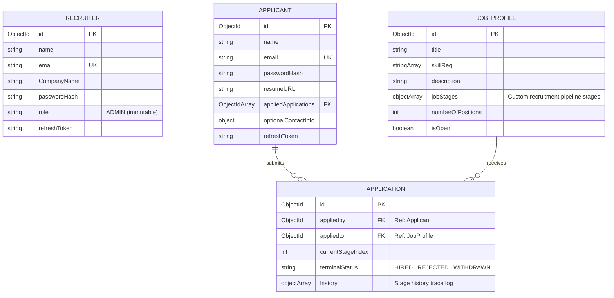
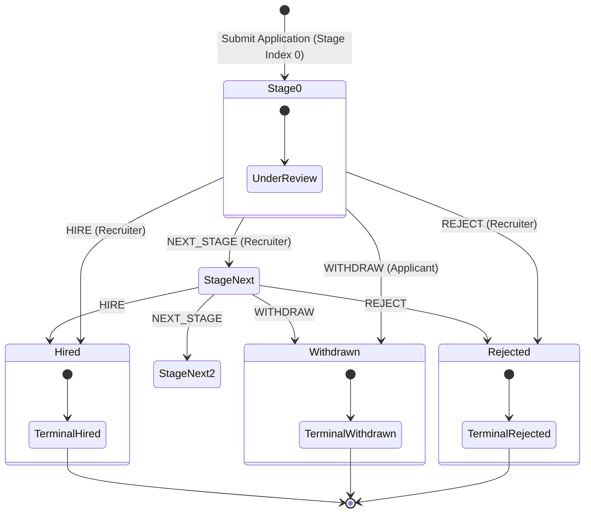

# Job Application Tracking System (ATS) - Project Review

Welcome to the **Job ATS Project** review document. This document provides a comprehensive overview of the system architecture, directory structure, data models, APIs, and state machine workflow for this backend service.

---

## 🛠️ Tech Stack & Architecture

The project is built as a robust, scaleable REST API using:
*   **Runtime:** Node.js (ES Modules syntax: `import/export`)
*   **Framework:** Express.js (v5.2.1)
*   **Database:** MongoDB via Mongoose (v9.0.2)
*   **Authentication & Security:** JWT (JSON Web Tokens), `bcrypt` for password hashing, and cookies for secure token refresh handling.
*   **Development Tools:** `nodemon` for hot-reloading during development.

The architecture follows a clean MVC/layered pattern split into **Routes**, **Controllers**, **Models**, **Middlewares**, and **Utility helpers**.

### Current implementation status

The backend has moved from a basic ATS prototype to a more complete MVP. The following capabilities are now implemented as part of the ongoing completion work:

- Applicant self-service auth with signup, login, refresh, and logout
- Controlled recruiter provisioning through the seed/admin workflow, plus recruiter login, refresh, and logout
- Applicant profile fetch and update endpoints
- Resume URL update endpoint for applicant profile
- Recruiter profile read endpoint
- Backend health check route for service monitoring
- Explicit job validation and closed-job application checks
- Stronger update guardrails for job creation and editing
- Recruiter dashboard statistics endpoint for business monitoring
- Resume URL validation to ensure profile data quality
- Resume file upload support for PDF/DOC/DOCX with type and size checks
- Documentation updates to reflect completed pieces and next steps

This keeps the project aligned with the original layered architecture while completing the most important missing backend functionality.

### Business rules enforced in the ATS backend

The system now enforces a number of business rules that are essential for a reliable ATS workflow:

1. A job cannot be created without a title, description, at least one stage, and a valid positive number of positions.
2. A job cannot be applied to when it is marked as closed (`isOpen === false`).
3. Application state transitions are only valid while the application is not in a terminal status.
4. Recruiter and applicant actions are authorized by role-specific middleware before any state-changing request is processed.
5. Updates to job details preserve data consistency and reject invalid values instead of silently accepting them.
6. Applicants may only withdraw their own applications; recruiters may only perform recruiter actions on applications that are still active.
7. Applications cannot be advanced beyond the end of the job stage list, and invalid transitions are rejected before database writes occur.
9. Resume URLs must be valid HTTP/HTTPS URLs before being accepted into the applicant profile.
10. Resume files must be under 2MB and must be uploaded as PDF, DOC, or DOCX only.
11. Recruiter dashboard requests are protected by admin-only auth middleware and expose aggregated ATS monitoring data.

These rules are important because they prevent invalid data entry, protect the application lifecycle, and keep recruiter-only actions secure.

### Production-readiness milestone

The next milestone is to convert this ATS backend from a working MVP into a deployment-ready service by focusing on test infrastructure, API validation, and operational hardening.

Planned work for this phase:
- Replace placeholder test setup with a real Jest + Supertest workflow
- Add automated API coverage for auth, jobs, and applicant flows
- Validate environment configuration and fail-fast startup checks
- Improve security hardening for cookies, CORS, and request validation
- Prepare the project for CI/CD and deployment conventions

### Final completion status

The backend has reached a stable MVP state for the core ATS workflow, with the remaining work focused on expansion and polish: richer recruiter operations, more detailed applicant profile storage, testing coverage across all routes, and production-hardening for deployment.

---

## 📁 Directory Structure

Here is the high-level outline of the project directory:

```bash
Job-ATS-project/
├── .env                     # Configuration file for environment variables
├── .env.example             # Template file for setting up the environment variables
├── package.json             # Project dependencies, metadata, and dev scripts
├── src/
│   ├── index.js             # Application entry point (initializes DB connection & starts server)
│   ├── app.js               # Express application config (middleware setup & base routes definition)
│   ├── constants.js         # Project-wide static constants (e.g. DB name)
│   ├── db/
│   │   └── index.js         # MongoDB connection setup
│   ├── models/              # Mongoose data schemas
│   │   ├── recruiter.model.js
│   │   ├── applicant.model.js
│   │   ├── jobProfile.model.js
│   │   └── application.model.js
│   ├── routes/              # Express API route declarations
│   │   ├── auth.route.js
│   │   ├── applicant.route.js
│   │   ├── job.route.js
│   │   └── application.route.js
│   ├── controller/          # Business logic handlers for the routes
│   │   ├── auth.controller.js
│   │   ├── applicant.controller.js
│   │   ├── job.controller.js
│   │   └── application.controller.js
│   ├── middleware/          # Express route middlewares (Auth, Roles, Errors)
│   │   ├── auth.middleware.js
│   │   ├── authorizeRoles.middleware.js
│   │   └── error.middleware.js
│   ├── utils/               # Common helper classes and functions
│   │   ├── ApiError.js      # Global error model
│   │   ├── ApiResponse.js   # Global API response formatter
│   │   ├── asyncHandler.js   # Helper wrapper for async route catch blocks
│   │   ├── token.js         # JWT generation utilities
│   │   └── applicationFsm.js# Finite State Machine for Application status transitions
│   └── scripts/             # Administrative/utility scripts
│       └── seedRecruiter.js # Seeds the default ADMIN recruiter user
```

---

## 💾 Data Models & Relations

The backend is backed by 4 main Mongoose collections. Below is a detailed view of their properties and relationships.



### 1. [Recruiter Model](file:///d:/Aryan/Projects/Job-ATS-project/src/models/recruiter.model.js)
*   Represents users with the **`ADMIN`** role.
*   **Properties:** `name`, `email` (unique, lowercase), `CompanyName`, `passwordHash` (hidden by default), `role` (strictly `"ADMIN"`, immutable), `refreshToken`.
*   Includes `comparePassword()` method and a pre-save hook that automatically hashes passwords when updated/created.

### 2. [Applicant Model](file:///d:/Aryan/Projects/Job-ATS-project/src/models/applicant.model.js)
*   Represents job seekers.
*   **Properties:** `name`, `email` (unique, lowercase), `passwordHash` (hidden by default), `resumeURL`, `appliedApplications` (References list of `Application` IDs), `optionalContactInfo`, `refreshToken`.
*   Includes `comparePassword()` method and password hashing hooks.

### 3. [JobProfile Model](file:///d:/Aryan/Projects/Job-ATS-project/src/models/jobProfile.model.js)
*   Defines a job listing with a customized pipeline.
*   **Properties:** 
    *   `title`
    *   `description`
    *   `skillReq` (Array of Strings representing required skills)
    *   `jobStages` (Ordered Array of sub-documents representing stages, e.g. `[{ name: "Resume Review" }, { name: "Technical Round" }, { name: "HR Interview" }]`)
    *   `numberOfPositions`
    *   `isOpen` (Boolean toggling list active status)

### 4. [Application Model](file:///d:/Aryan/Projects/Job-ATS-project/src/models/application.model.js)
*   Represents an applicant's submission for a job.
*   **Properties:**
    *   `appliedby` (Reference to `Applicant`)
    *   `appliedto` (Reference to `JobProfile`)
    *   `currentStageIndex` (Refers to index in the `JobProfile.jobStages` array)
    *   `terminalStatus` (Optional status representation: `"HIRED"`, `"REJECTED"`, or `"WITHDRAWN"`)
    *   `history` (A nested log record storing past stage moves, action names, timestamp, and executing user role)

---

## ⚙️ Application State Machine (FSM)

The lifecycle of an `Application` is managed by a Finite State Machine implemented in [applicationFsm.js](file:///d:/Aryan/Projects/Job-ATS-project/src/utils/applicationFsm.js). This ensures that application state transitions remain logical and valid.



### FSM Rules & Transitions:
1.  **Terminal States:** Once an application receives a terminal status (`HIRED`, `REJECTED`, or `WITHDRAWN`), **no further state transitions are allowed**.
2.  **`NEXT_STAGE`:** Increments `currentStageIndex` by `1`. Throws an error if there are no more stages defined in the `JobProfile.jobStages` pipeline.
3.  **`REJECT`:** Halts progression and sets `terminalStatus = "REJECTED"`.
4.  **`WITHDRAW`:** Allows applicant to withdraw their application. Sets `terminalStatus = "WITHDRAWN"`.
5.  **`HIRE`:** Completes the workflow and sets `terminalStatus = "HIRED"`.

---

## 🔒 Security & Authentication Flow

Authentication is built using a secure split-token flow:
1.  **Access Token:** Short-lived JWT passed via the `Authorization` header (`Bearer <token>`). Used to authorize direct API requests.
2.  **Refresh Token:** Long-lived JWT set as an `HttpOnly`, `secure` (in production), and `sameSite` cookie. Used to request a new access token without re-entering credentials.

### Middlewares
*   [verifyJwt](file:///d:/Aryan/Projects/Job-ATS-project/src/middleware/auth.middleware.js): Validates the access token in the headers and attaches `req.user = { id, role }` to the request object.
*   [authorizeRoles](file:///d:/Aryan/Projects/Job-ATS-project/src/middleware/authorizeRoles.middleware.js): Validates that the logged-in user possesses one of the allowed roles for the specific endpoint.

---

## 🌐 API Reference

Below is a tabular list of all endpoints exposed by the service:

### 1. Authentication Endpoints (`/api/v1/auth`)

| Method | Endpoint | Auth | Role | Description |
| :--- | :--- | :---: | :---: | :--- |
| `POST` | `/login` | None | Anyone | Logs in an applicant. Sets `refreshToken` cookie, returns access token. |
| `POST` | `/refresh` | None | Anyone | Uses refresh token cookie to get a new Applicant access token. |
| `POST` | `/logout` | None | Anyone | Logs out an applicant. Clears cookies and nulls refresh token in DB. |
| `POST` | `/recruiter/login` | None | Anyone | Logs in a provisioned recruiter. Sets `refreshToken` cookie, returns access token. |
| `POST` | `/recruiter/refresh` | None| Anyone | Uses refresh token cookie to get a new Recruiter access token. |
| `POST` | `/recruiter/logout` | None | Anyone | Logs out a recruiter. Clears cookies. |

### 2. Applicants Endpoints (`/api/v1/applicants`)

| Method | Endpoint | Auth | Role | Description |
| :--- | :--- | :---: | :---: | :--- |
| `POST` | `/signup` | None | Anyone | Registers a new Applicant. Sets refresh cookie, returns access token. |
| `POST` | `/apply/:jobId` | JWT | `APPLICANT` | Applies to a job. Creates application under stage 0, logs history. |

### 3. Job Profile Endpoints (`/api/v1/jobs`)

| Method | Endpoint | Auth | Role | Description |
| :--- | :--- | :---: | :---: | :--- |
| `GET` | `/` | JWT | Any | Returns list of all job profiles sorted by creation date. |
| `GET` | `/:id` | JWT | Any | Returns details of a specific job profile. |
| `POST` | `/` | JWT | `ADMIN` | Creates a new job profile containing stages. |
| `PATCH` | `/:id` | JWT | `ADMIN` | Modifies properties (title, description, stages, positions) of a job. |
| `DELETE` | `/:id` | JWT | `ADMIN` | Deletes a job profile. |

### 4. Applications Endpoints (`/api/v1/applications`)

| Method | Endpoint | Auth | Role | Description |
| :--- | :--- | :---: | :---: | :--- |
| `GET` | `/` | JWT | Any | Returns applications. **Applicants** see only their own; **ADMIN** sees all. |
| `GET` | `/filter` | JWT | Any | Returns filtered applications based on `terminalStatus`, `jobId`, or `applicantId`. |
| `GET` | `/:id` | JWT | Any | Returns details of a single application (includes authorization checks). |
| `PATCH` | `/:id/advance` | JWT | `ADMIN` | Transitions application to the next defined stage. |
| `PATCH` | `/:id/reject` | JWT | `ADMIN` | Rejects the application (moves status to `REJECTED`). |
| `PATCH` | `/:id/withdraw`| JWT | `APPLICANT` | Withdraws the application (moves status to `WITHDRAWN`). |
| `PATCH` | `/:id/hire` | JWT | `ADMIN` | Hires the applicant (moves status to `HIRED`). |

### API error contract

Validation, authorization, missing-resource, and unknown-route failures return JSON in this shape:

```json
{
    "success": false,
    "message": "A human-readable error message",
    "errors": []
}
```

---

## 🚀 Running the Project Locally

### 1. Prerequisite Environment Config
Create a file named `.env` in the root folder using [.env.example](file:///d:/Aryan/Projects/Job-ATS-project/.env.example) as reference:
```env
PORT=8000
NODE_ENV=development
CORS_ORIGIN=http://localhost:5173
MONGODB_URI=mongodb://localhost:27017
JWT_ACCESS_SECRET=your_access_token_secret_here
JWT_ACCESS_EXPIRY=1d
JWT_REFRESH_SECRET=your_refresh_token_secret_here
JWT_REFRESH_EXPIRY=10d
```

### 2. Seed Recruiter Account (Required for Admin actions)
An administrative recruiter must be seeded in the database. Run the following command:
```bash
node src/scripts/seedRecruiter.js
```
*   **Default Admin Username:** `admin@company.com`
*   **Default Admin Password:** `admin@040`

### 3. Run Dev Server
Start the development server using:
```bash
npm run dev
```
The server will boot up using `nodemon` on the port specified in your `.env` (default is `8000`).
